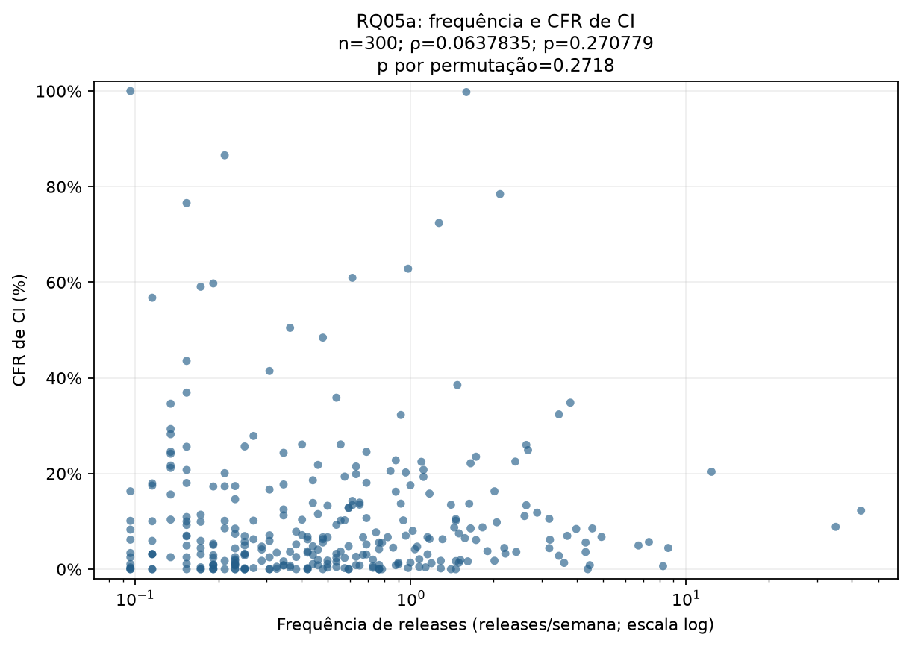
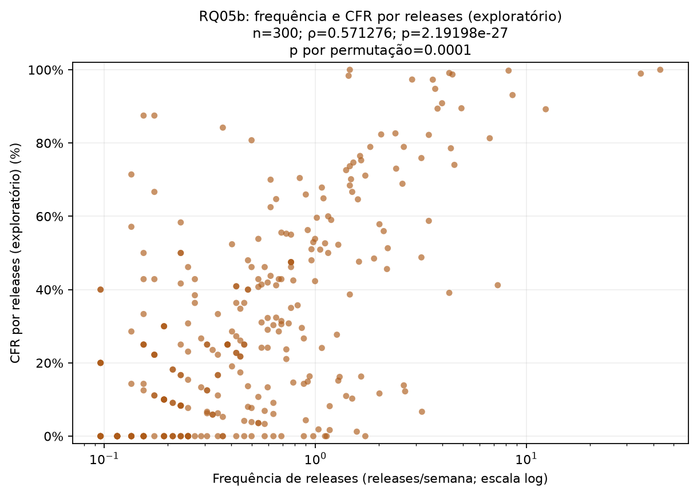
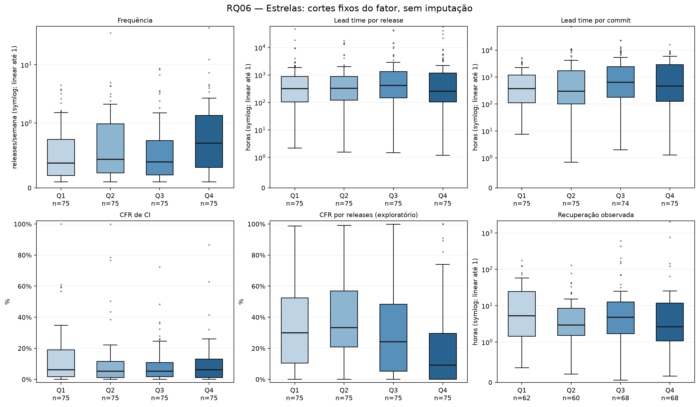
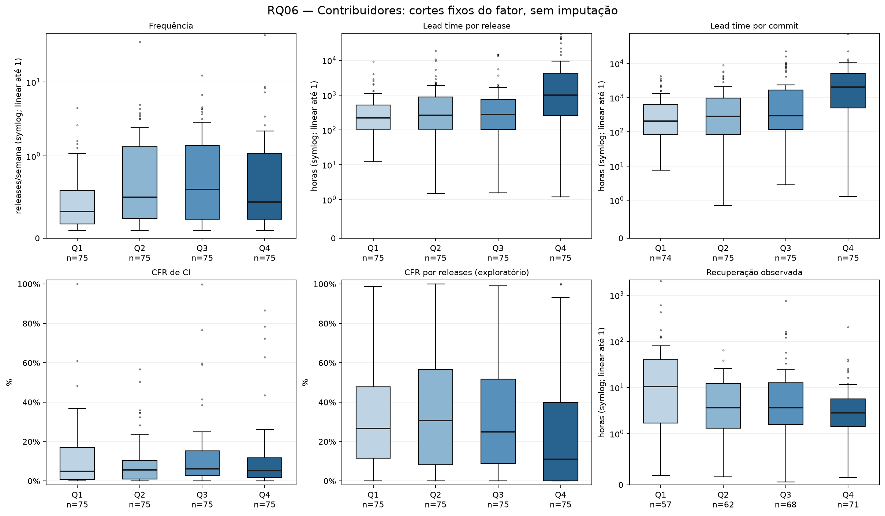
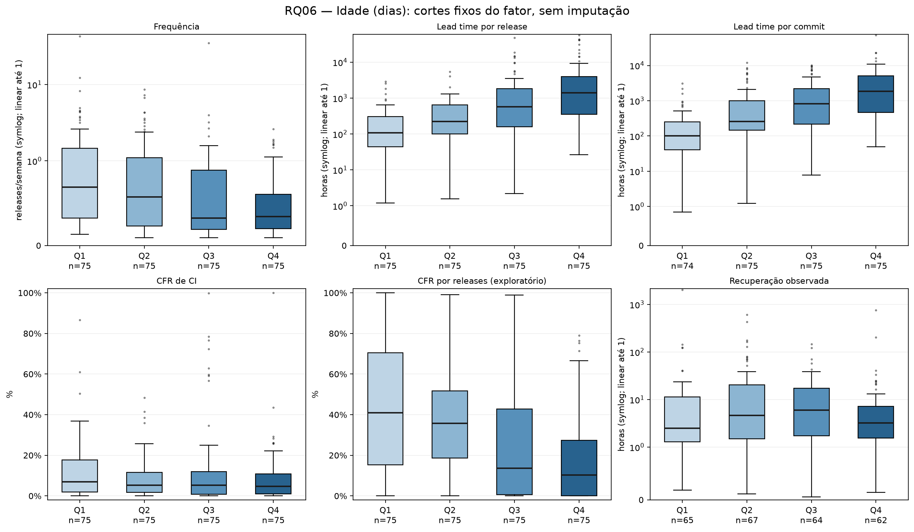

# Issue #8 — RQ05 e RQ06

Base: **300 repositórios**, uma linha e um peso por projeto, janela UTC **2025-01-01 a 2025-12-31**. Análise local, sem token ou nova coleta. O CSV original não foi alterado.

## Método

O plano fixado no código usa duas correlações de Spearman bilaterais e uma família de 18 testes (três fatores × seis medidas). Estrelas, contribuidores e idade foram escolhidos antes da execução por estarem disponíveis para a coorte, sem depender do tipo de projeto ainda sem consenso. Não houve seleção de fatores ou métodos por p-valor.

Ausentes, números não finitos, durações/frequências negativas e proporções fora de [0,1] são excluídos apenas da análise afetada. O apóstrofo de proteção é removido somente na conversão numérica. Valores zero reais são preservados. As exclusões por análise estão em `exclusions.csv` e as ocorrências por coluna em `quality-warnings.csv`.

O p de Spearman fornecido pelo SciPy é assintótico. Como n<500, também relatamos uma verificação Monte Carlo bilateral por permutação de um vetor de postos, com correção (extremos+1)/(B+1). Esse resultado é adicional e não substitui silenciosamente o método pedido. Não houve interrupção por significância.

Permutações por par: **9999**; sementes: **42 e 43**. A resolução mínima do p Monte Carlo é 1/(B+1); não se trata de enumeração exata de todas as permutações.

Os quartis usam interpolação linear. Cada fator recebe cortes uma única vez, na base inteira válida desse fator, antes de filtrar cada métrica. Intervalos são (inferior, superior], com extremos abertos ilimitados. Bordas repetidas e intervalos vazios são coalescidos; valores empatados nunca são separados para equilibrar n.

Com três ou mais grupos não vazios usamos Kruskal–Wallis, com correção de empates, e ε²=H/(n−1), conforme a fórmula exigida no README. Com dois grupos usamos Mann–Whitney bilateral e δ=2U1/(n1×n2)−1, mantendo a ordem crescente dos grupos. O método exato é usado apenas com min(n1,n2)≤8 e sem empates; nos demais casos usa-se aproximação com correção de empates e continuidade. Grupos com n<5 são sinalizados. Não há teste de normalidade ou post-hoc nesta entrega.

Holm é aplicado em uma única família aos p-valores estimáveis dos 18 testes planejados, α=0,05. A saída registra o número planejado e o efetivamente corrigido. Não estimável permanece vazio, nunca vira p=1 ou efeito zero. Os dois testes da RQ05 são relatados separadamente e não entram na família da RQ06.

## Qualidade e tamanhos de amostra

| Medida | n válido | Ausentes/inválidos |
|---|---:|---:|
| Frequência | 300 | 0 |
| Lead time por release | 300 | 0 |
| Lead time por commit | 299 | 1 |
| CFR de CI | 300 | 0 |
| CFR por releases (exploratório) | 300 | 0 |
| Recuperação observada | 258 | 42 |

Valor excluído da medida afetada: `tw93/Mole`, `lead_time_commit_median_hours`, motivo `negative_value`. A fonte permanece intacta.

## RQ05 — Frequência e falhas

| Proxy | n | ρ | p assintótico | p permutação | Estado |
|---|---:|---:|---:|---:|---|
| cfr_ci | 300 | 0.0637835 | 0.270779 | 0.2718 | estimated |
| cfr_b | 300 | 0.571276 | 2.19198e-27 | 0.0001 | estimated |

**RQ05a:** associação monotônica positiva, com |ρ|=0.0637835. O sinal descreve a tendência observada entre projetos; não mede efeito causal de aumentar a frequência. O proxy de CI mede falha de pipeline, não falha comprovada em produção.

O teste bilateral não detecta evidência de associação a 5%; isso não demonstra ausência de relação.

**RQ05b:** associação monotônica positiva, com |ρ|=0.571276. O sinal descreve a tendência observada entre projetos; não mede efeito causal de aumentar a frequência. O proxy baseado em releases permanece exploratório, sem validação final da heurística.

O teste bilateral detecta evidência de associação a 5%.





## RQ06 — Grupos de projetos

| Fator | Q1 | Mediana | Q3 | Grupos e n do fator |
|---|---:|---:|---:|---|
| Estrelas | 40030.5 | 50393.5 | 76679.8 | Q1: 75; Q2: 75; Q3: 75; Q4: 75 |
| Contribuidores | 268 | 539.5 | 1135.75 | Q1: 75; Q2: 75; Q3: 75; Q4: 75 |
| Idade (dias) | 1171.79 | 2442.25 | 3825.34 | Q1: 75; Q2: 75; Q3: 75; Q4: 75 |

Cortes efetivos e limites por grupo estão em `factor-cuts.json`; atribuições por projeto em `rq06-group-assignments.csv`. Medianas, Q1, Q3, IQR e n por grupo/medida estão em `rq06-group-summary.csv`.

| Fator | Medida | n | Teste | p bruto | p Holm | Efeito | Rejeita a 5% |
|---|---|---:|---|---:|---:|---:|---|
| Estrelas | Frequência | 300 | kruskal_wallis | 0.00607575 | 0.0607575 | ε²=0.041537 | não |
| Estrelas | Lead time por release | 300 | kruskal_wallis | 0.730624 | 1 | ε²=0.00432683 | não |
| Estrelas | Lead time por commit | 299 | kruskal_wallis | 0.217978 | 1 | ε²=0.0148893 | não |
| Estrelas | CFR de CI | 300 | kruskal_wallis | 0.826407 | 1 | ε²=0.00299647 | não |
| Estrelas | CFR por releases (exploratório) | 300 | kruskal_wallis | 9.07632e-05 | 0.00108916 | ε²=0.0712713 | sim |
| Estrelas | Recuperação observada | 258 | kruskal_wallis | 0.145391 | 1 | ε²=0.0209713 | não |
| Contribuidores | Frequência | 300 | kruskal_wallis | 0.00335349 | 0.0368884 | ε²=0.0457976 | sim |
| Contribuidores | Lead time por release | 300 | kruskal_wallis | 2.3625e-06 | 3.30749e-05 | ε²=0.0966201 | sim |
| Contribuidores | Lead time por commit | 299 | kruskal_wallis | 5.36665e-11 | 8.58664e-10 | ε²=0.170508 | sim |
| Contribuidores | CFR de CI | 300 | kruskal_wallis | 0.444405 | 1 | ε²=0.0089482 | não |
| Contribuidores | CFR por releases (exploratório) | 300 | kruskal_wallis | 0.0100084 | 0.0900753 | ε²=0.0379366 | não |
| Contribuidores | Recuperação observada | 258 | kruskal_wallis | 0.0177368 | 0.141894 | ε²=0.0392987 | não |
| Idade (dias) | Frequência | 300 | kruskal_wallis | 8.32125e-05 | 0.00108176 | ε²=0.0718783 | sim |
| Idade (dias) | Lead time por release | 300 | kruskal_wallis | 5.9039e-19 | 1.00366e-17 | ε²=0.294298 | sim |
| Idade (dias) | Lead time por commit | 299 | kruskal_wallis | 4.09125e-19 | 7.36424e-18 | ε²=0.297774 | sim |
| Idade (dias) | CFR de CI | 300 | kruskal_wallis | 0.299109 | 1 | ε²=0.0122815 | não |
| Idade (dias) | CFR por releases (exploratório) | 300 | kruskal_wallis | 1.7053e-08 | 2.55796e-07 | ε²=0.130556 | sim |
| Idade (dias) | Recuperação observada | 258 | kruskal_wallis | 0.208034 | 1 | ε²=0.0176971 | não |

Dos **18 testes planejados**, **18 foram estimáveis** e **8 rejeitaram a hipótese nula após Holm**. A rejeição indica diferenças entre distribuições; não identifica automaticamente pares de grupos ou um fator causal.

**Estrelas:** diferenças detectadas após Holm em CFR por releases (exploratório).

**Contribuidores:** diferenças detectadas após Holm em Frequência, Lead time por release, Lead time por commit.

**Idade (dias):** diferenças detectadas após Holm em Frequência, Lead time por release, Lead time por commit, CFR por releases (exploratório).







## Discussão e limitações

As correlações relacionam métricas agregadas por repositório. Elas não constituem, sozinhas, confirmação ou refutação causal da hipótese de ausência de trade-off entre velocidade e estabilidade. Releases não são deploys comprovados, e falhas de CI não são incidentes de produção. Diferenças entre os dois proxies podem refletir sua construção e disponibilidade.

Popularidade e contribuidores são fotografias obtidas na coleta, posteriores à janela de 2025; não são medidas históricas garantidas desse ano. Idade, popularidade e contribuidores podem ser associados entre si. Os testes são univariados e Holm controla multiplicidade, não confundimento. Projetos populares selecionados com mínimos de atividade não representam todas as equipes de software.

Kruskal–Wallis e Mann–Whitney comparam distribuições por postos. Sem hipóteses adicionais sobre suas formas, não atribuímos toda diferença apenas à mediana. As magnitudes de δ seguem os cortes do README; não aplicamos esses cortes ao ε². A recuperação resume apenas episódios encerrados e pode sofrer influência da censura.

CFR (b) conserva o estado de validação da fonte: pending_independent_labels. Não foram criados rótulos, consenso ou F1 nesta análise. Tipo do projeto não foi usado porque o consenso da amostra de 60 projetos ainda não está disponível para a coorte inteira. Rework rate e análise de sensibilidade permanecem nas entregas dos colegas.

## Reprodução

```powershell
python -m pip install -r scripts/requirements-rq05-rq06.txt
python scripts/analyze-rq05-rq06.py --dataset data/dataset-s02-final/dataset.csv --output output/rq05-rq06
python -m pytest tests/test_rq05_rq06.py -q
```

O manifesto registra hash da fonte, plano, cortes, n, exclusões, métodos e versões. Para replicar o ambiente usado nesta execução, consulte também `dependency-versions.json`. Os SVGs e PNGs são gerados pelo mesmo script. O relatório contribui para resultados/discussão do artigo (#10).

## Referências de implementação

- [spearman](https://docs.scipy.org/doc/scipy/reference/generated/scipy.stats.spearmanr.html)
- [kruskal](https://docs.scipy.org/doc/scipy/reference/generated/scipy.stats.kruskal.html)
- [mannwhitney](https://docs.scipy.org/doc/scipy/reference/generated/scipy.stats.mannwhitneyu.html)
- [holm](https://www.statsmodels.org/stable/generated/statsmodels.stats.multitest.multipletests.html)
